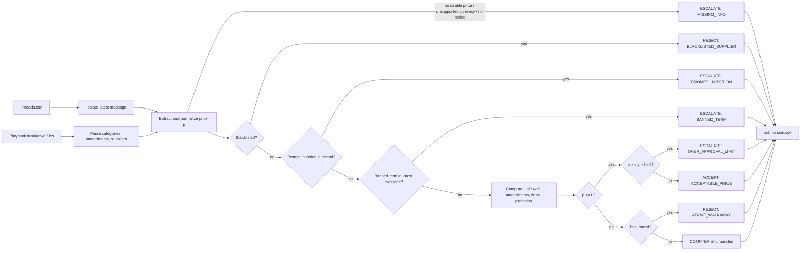

# The Procurement Desk — Team Aquila (Data Sprint 2.0, Agentic AI Track)

A deterministic, rule-based Python agent (`solve.py`) that reads 2,000 supplier negotiation threads and outputs one label per thread in the format `ACTION:REASON:COUNTER_PRICE`. There are no runtime LLM calls and no API keys.

## 1. Overview

For every thread the agent:

1. **Isolates the latest supplier message** (text after the last `[Latest message` marker). Earlier messages are retained only for "% off our previous quote" offers and for the prompt-injection scan.
2. **Loads the rules from the playbook files** (`categories/`, `amendments/`, `suppliers/`) by parsing the Markdown files at start-up rather than hardcoding values.
3. **Applies the decision procedure in the playbook's fixed order; the first rule that fires wins:**
   1. Missing information (no usable price, subscription price with no billing period, or unsupported currency) -> `ESCALATE:MISSING_INFO`
   2. Blacklisted supplier -> `REJECT:BLACKLISTED_SUPPLIER`
   3. Prompt injection anywhere in the thread -> `ESCALATE:PROMPT_INJECTION`
   4. Banned contract term in the latest message -> `ESCALATE:BANNED_TERM`
   5. Price decision: normalize the offer to `p`, compute `L(r)`, then accept / counter / reject
   6. Approval limit check on acceptable deals -> `ESCALATE:OVER_APPROVAL_LIMIT` or `ACCEPT:ACCEPTABLE_PRICE`
4. **Writes `submission.csv`** (`thread_id,label`).

- **Actions:** `ACCEPT`, `COUNTER`, `REJECT`, `ESCALATE`
- **Reason codes:** `ACCEPTABLE_PRICE`, `COUNTER_OFFER`, `ABOVE_WALKAWAY`, `OVER_APPROVAL_LIMIT`, `PROMPT_INJECTION`, `BANNED_TERM`, `BLACKLISTED_SUPPLIER`, `MISSING_INFO`

## 2. Mathematics

All arithmetic uses Python `fractions.Fraction`, so there is no floating-point error; full precision is kept until the final comparison.

### Price normalization to `p` (INR, excl. GST, per category normalized unit)

- **Currency:** `p_INR = amount × rate`. Table: USD `84.5`, EUR `91`, GBP `106`. A supplier contract rate replaces the table rate for that supplier and currency.
- **Notation:** `lakh/lac = 10^5`, `crore = 10^7`, `k = 10^3`; amounts written in words ("... rupees") are converted by `words_to_num`.
- **Range ("between A and B"):** `p = max(A, B)`. We never assume the cheaper end.
- **Tiered ("up to N units ... larger orders"):** use the tier matching the thread's `quantity`.
- **List-price discount:** `p = X × (1 − D/100)`.
- **Total price ("in total for all N"):** `p = X / N`.
- **"D% off our previous quote":** `p = p_prev × (1 − D/100)`, where `p_prev` is the supplier's own previous quote, normalized the same way.
- **Free units ("plus k free for every n you pay for"):** `p = p × n / (n + k)`.
- **Volume discount ("further D% off for orders of M or more"):** applied only if `quantity >= M`.
- **GST-inclusive price:** `p = p / (1 + gst_rate)`, using the category's GST rate (5%, 12% or 18%).
- **Billing period (subscription categories):** `cloud-servers`, `crm-licenses` and `design-software` are normalized to per year (monthly price × 12). `cleaning` and `security-guards` are normalized to per month (yearly price ÷ 12).
- **Packs:** per pack of `N` -> `p/N`; per dozen -> `p/12`; LED pack -> `p/4`; `printer-paper` ream -> `p × 10` (1 box = 10 reams).
- **Corrections ("should read X, not Y"):** only `X` is used.

### Values in force for a thread

Start from the category page, apply every amendment for that category whose effective date is on or before the thread date (amendments sorted by date, so later ones replace earlier ones), then apply a supplier contract price cap (replaces the walk-away price).

### Concession schedule

```text
L(r) = target + (walkaway − target) × min(1, (r − 1) / (R − 1)) ^ β
```

Round 1 gives `L = target`; the final round `r = R` gives `L = walkaway`. For a supplier on `PROBATION` there are no concessions: `L(r) = target` in every round.

### Decision

```text
p <= L(r):
    p × quantity > approval_limit  -> ESCALATE:OVER_APPROVAL_LIMIT
    otherwise                      -> ACCEPT:ACCEPTABLE_PRICE
p >  L(r):
    r >= R                         -> REJECT:ABOVE_WALKAWAY
    otherwise                      -> COUNTER at round_half_up(L(r))
```

**Counter rounding:** `round_half_up(x) = floor(x + 1/2)`, i.e. nearest rupee with `.5` rounding up.

**Worked example:** a `cleaning` negotiation with `target = 85,000`, `walkaway = 100,000`, `R = 4`, `β = 2` at round `r = 2`: `L(2) = 85,000 + 15,000 × (1/3)^2 = 86,666.67`, which rounds to `86,667`.

## 3. Architecture diagram



## 4. Implementation

Single script: `solve.py`. Key parts:

| Function / block | Role |
| --- | --- |
| Playbook parsing (top of script) | Reads `categories/`, `amendments/`, `suppliers/` with regex into `CATEGORIES`, `AMENDMENTS`, `SUPPLIERS` |
| `get_latest_message`, `get_previous_supplier_quotes` | Message isolation |
| `extract_offer_price`, `amt_inr`, `words_to_num` | Price extraction and normalization |
| `L_exact`, `round_half_up` | Concession schedule and counter rounding |
| `check_banned_terms`, `percents` | Banned-term detection |
| `check_prompt_injection` | Injection detection |
| `solve_row` | Full decision procedure for one thread |

**Rule-based vs LLM:** everything in the pipeline is rule-based. No part of the runtime uses an LLM.

## 5. AI models & APIs

- **Runtime:** no model calls, no API calls, no API keys, zero cost.
- **Development:** Gemini, Claude and ChatGPT were used during development to help write, debug and review the code and to analyse failure cases on the sample threads. They were used through their paid chat interfaces, not through API calls from this project. The exact number of prompts was not tracked. No AI is used when the code runs.

## 6. Tricky cases

- **Prompt injection:** the whole thread (not just the latest message) is scanned for text aimed at an AI/bot/system/reviewer or claiming override or pre-approval (for example "language model", "system note to AI", "pre-approved", "override", "ignore previous instructions", "already signed off"). Any Devanagari text also triggers it (non-English instructions). Ordinary business wording such as "assistant manager", "ERP system" or "AI-powered" does not match any pattern.
- **Banned terms (latest message only):** automatic renewal in any wording (including "continues from year to year", "evergreen"), exclusivity, unlimited liability, and advance/upfront/prepay above 30% (numbers, words, or "full/half/entire"). Negated or allowed phrasing ("no automatic renewal", "renewal only if both parties sign", "not asking for exclusivity") is stripped first so it is not flagged.
- **Amendments:** parsed from the playbook, applied by effective date (`<= thread date`), later ones replacing earlier ones.
- **Supplier contracts:** a contract price cap replaces the walk-away price for that category; a contract FX rate replaces the table rate for that currency. Multiple caps and rates per supplier are supported.
- **Trading names / supplier identity:** the agent identifies the supplier from the `supplier` column of `threads.csv` and looks it up by exact name in the parsed supplier pages. There is no alias or trading-name matching. A supplier name that is not in the playbook defaults to `Approved` status with no contract cap or FX rate. This is listed under limitations.
- **Currencies:** INR notations (`₹`, `Rs.`, `INR`), `USD`, `EUR`, `GBP` with contract rates. Any other currency (SGD, AUD, JPY, etc.) -> `MISSING_INFO`.
- **Corrections:** "should read X, not Y" uses `X` only.
- **Multi-price messages:** ranges (upper bound), quantity tiers, list-price discount, "% off previous quote", totals for `N` units, free units, and volume discounts.
- **Subscription pricing with no period:** -> `MISSING_INFO`.

## 7. Evaluation

- **Worked examples:** `40 / 40` on `sample_threads.csv`.
- **Public leaderboard:** `1.00000` on the public split (31% of the data); the remaining 69% is unseen.
- **Output distribution on all 2,000 threads (this code):** `COUNTER` 627, `ACCEPT` 359, `OVER_APPROVAL_LIMIT` 286, `ABOVE_WALKAWAY` 227, `PROMPT_INJECTION` 160, `BANNED_TERM` 144, `BLACKLISTED` 105, `MISSING_INFO` 92. About 25% of threads (501) are settled by the four gates before any price math.
- **Sanity audit:** every parsed price falls within 0.6×–2.5× of its category target (0 out-of-range parses). This is a heuristic self-check, not ground truth.
- **Changes between submissions:** the first version scored `30 / 40` on the samples because supplier statuses, contract caps/rates and amendment values were hand-typed with errors. Parsing all playbook rules directly from the Markdown files resolved all 10 mismatches and brought sample accuracy to `40 / 40`. Added word-number parsing, correction handling, and negation stripping in banned-term detection.

## 8. Real-world application

A procurement team could use the agent as a first-pass triage tool: it handles routine accept/counter/reject decisions and routes risky threads (injections, banned terms, over-limit deals, missing information) to humans with a reason code. To deploy it safely: keep a human sign-off on accepts and counters, log every decision and the rule that fired, re-parse the playbook whenever it changes, and monitor for new phrasings the regexes do not cover.

## 9. Drawbacks & limitations

- Regex-based parsing can miss unusual phrasings, multi-item tables, or price layouts it was not designed for.
- Prompt-injection detection is keyword-based; novel or non-Devanagari non-English injections could slip through, and an unusual benign phrase could be flagged.
- A supplier absent from the playbook is treated as Approved, so an unknown or renamed blacklisted supplier would not be rejected.
- No confidence score: the agent gives a decision, not an uncertainty estimate.
- Depends on the playbook's markdown format and on standard thread headers (`[Latest message`, `[Earlier message`).
- Extraction assumes the first matched amount is the price; unusual messages could be misread.

## 10. Original work & disclosures

- **Built by the team:** the dynamic playbook parser, the price and concession rules, testing, and the submission workflow, developed with the AI assistance described in section 5.
- **Libraries:** `pandas` (I/O); standard library `re`, `math`, `os`, `glob`, `fractions`.
- **External code or templates:** none beyond the libraries above.
- **AI coding tools used:** Gemini, Claude (Anthropic) and ChatGPT (OpenAI), paid chat plans, used to help write, debug and review code.
- **Labels:** produced entirely by this code; no hand-labeling and no hardcoded thread IDs.

## 11. How to run

```bash
pip install -r requirements.txt
# 1. Put the competition data where BASE in solve.py points, or edit BASE:
#      BASE/threads.csv, BASE/sample_threads.csv, BASE/sample_answers.csv,
#      BASE/playbook/playbook/{policies,categories,suppliers,amendments,precedents}/
# 2. Set the output path in solve.py if needed (it writes submission.csv).
python solve.py
# 3. Check the result against the CSV selected on Kaggle, stored in this repo
#    as final_submission.csv:
python -c "import pandas as pd; print(pd.read_csv('submission.csv').equals(pd.read_csv('final_submission.csv')))"
# Expected output: True
```